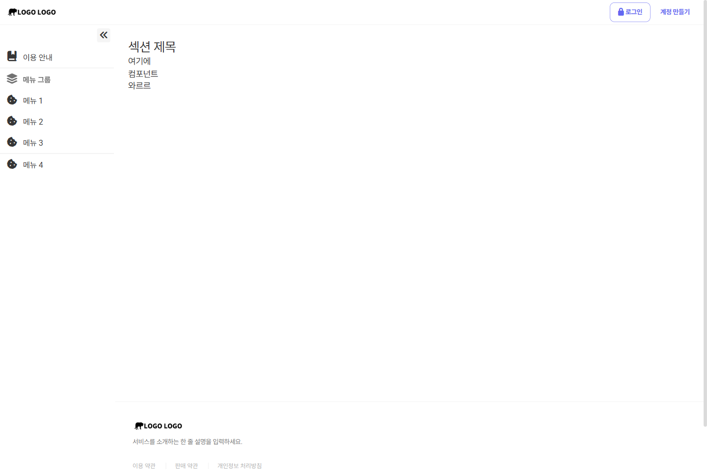
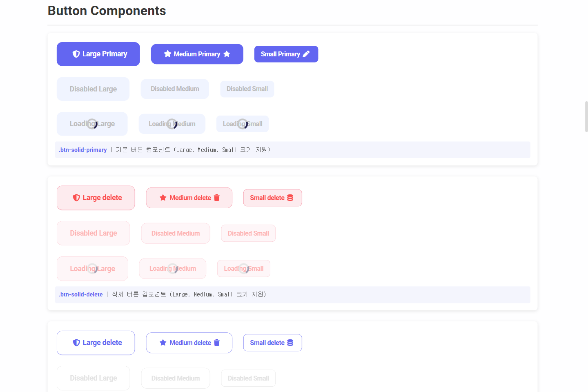
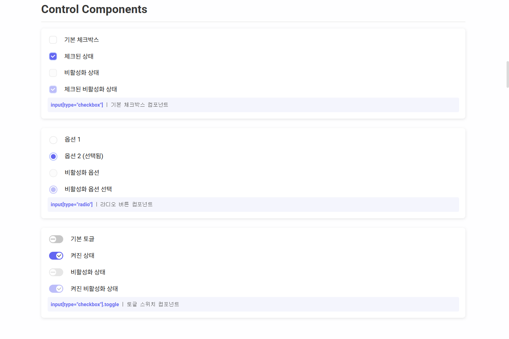
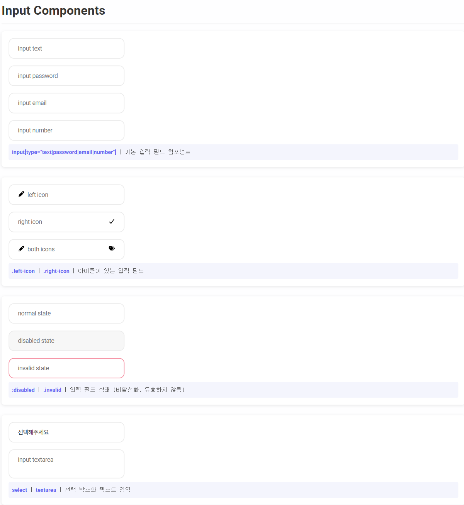
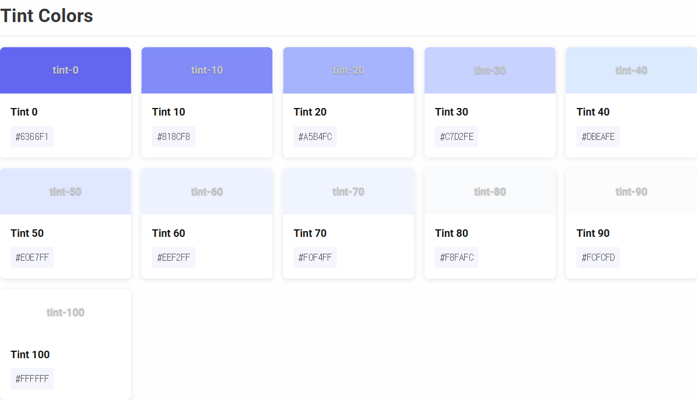
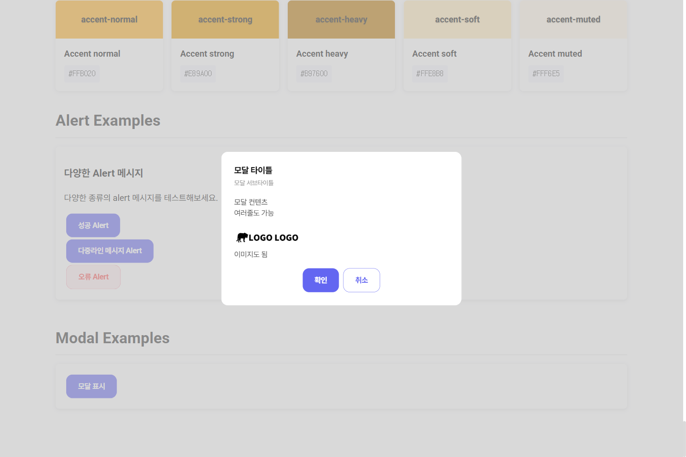
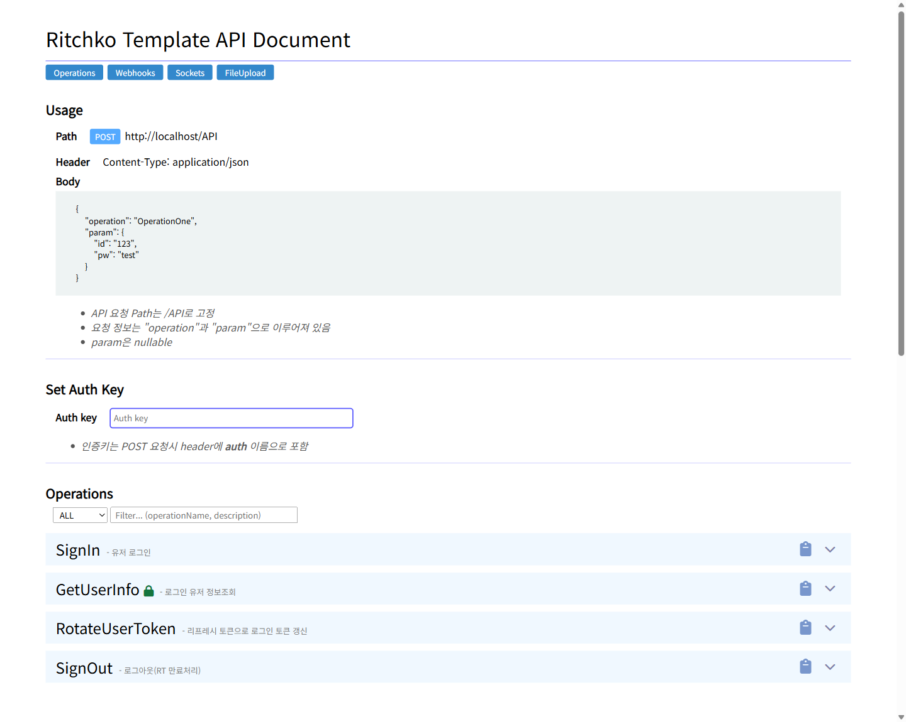
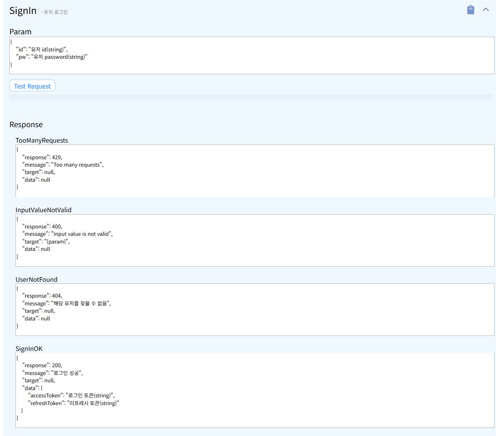

# Ritchko Template

**아이디어를 웹서비스로 옮길 때, 매번 만드는 기본 구조를 한곳에.**

HTML·SCSS·JavaScript 프론트엔드와 Express 백엔드, API 문서, 배포 설정을 함께 담은 개인 웹서비스용 Node.js 템플릿입니다. 소규모 서비스와 MVP를 빠르게 시작하고, 프로젝트가 달라져도 익숙한 구조로 작업하기 위해 만들었습니다.

[시작하기](./readme/run-main.md) · [프론트엔드](./readme/front-main.md) · [백엔드](./readme/backend-main.md) · [배포](./readme/deploy-main.md)

## 주요 기능

| 구성 | 제공하는 것 | 자세히 보기 |
| --- | --- | --- |
| 프론트엔드 | 반응형 레이아웃, 헤더·사이드바·푸터, SCSS 디자인 시스템과 컴포넌트 샘플 | [프론트엔드](./readme/front-main.md) |
| 백엔드 | Express 기반 `POST /API`와 operation 레지스트리, 인증·응답·공통 유틸 | [백엔드](./readme/backend-main.md) |
| API 문서 | operation·webhook·socket·파일 업로드 문서와 operation 요청 도구 | [API 문서](./readme/backend-main.md#api-docs) |
| 비동기 처리 | Socket.IO, Redis 유틸, worker·cron 등록 구조 | [기능별 가이드](./readme/backend-main.md#extensions) |
| 생성 도구 | 프론트 페이지와 백엔드 도메인·operation·webhook·socket·worker 스캐폴드 | [프론트](./readme/front-main.md#create-page) · [백엔드](./readme/backend-main.md#create-operation) |
| AI 개발 지원 | 영역별 작업 지침, 컨벤션·체크리스트로 에이전트의 구현 기준 명시 | [AGENTS.md](./AGENTS.md) · [컨벤션](./convention/README.md) |
| 실행·배포 | 서버 자동 재시작과 SCSS 감시, PM2, GitHub Actions 배포 workflow | [실행](./readme/run-main.md) · [배포](./readme/deploy-main.md) |

프론트는 별도 프레임워크나 번들러 없이 HTML·SCSS·JS로 작성하고, 공통 HTML은 EJS include로 조립합니다. 백엔드는 `/API` 요청의 `operation` 값으로 실행할 로직을 선택합니다.

## 화면 둘러보기

### 기본 레이아웃

헤더·사이드바·푸터를 포함한 기본 화면 구성과 모바일 반응형 레이아웃을 제공합니다.

### 디자인 시스템

크기와 상태별 버튼, 아이콘 입력 필드, 체크박스·토글, 컬러 팔레트와 모달까지 공통 UI를 제공합니다. 컴포넌트 샘플에는 적용할 클래스와 사용 예시가 함께 정리되어 있습니다.

컴포넌트 더 보기

**체크박스 · 라디오 · 토글**

**입력 필드 · 상태 표현**

**컬러 팔레트**

**모달**

### API 문서

API 사용 방식과 operation 목록을 확인할 수 있는 내장 문서를 제공합니다.

operation 항목을 펼치면 필요한 파라미터와 응답 종류·구조를 확인할 수 있습니다. 파라미터를 직접 수정해 테스트 요청을 보내는 기능도 포함합니다.

## 만든 이유

이미 많은 회사와 개발자가 사용하는 프레임워크와 라이브러리가 있지만, 수년간 이 구조로 프로젝트를 만들다 보니 익숙해졌습니다. MVP를 빠르게 구현해야 할 때마다 익숙한 방식을 찾게 되었고, 다른 프레임워크로 옮기기 점점 어려워지는 잠금효과도 생겼습니다.

혼자 프로젝트를 진행할 때는 문제가 없었지만, 다른 사람에게 제 코드를 소개하려니 어떤 구조와 도구를 사용하는지 설명할 자료가 필요했습니다. 그래서 그동안 사용해 온 것들을 정리해 공개했습니다.

이후에는 AI 에이전트와 함께 개발할 때도 프로젝트의 구조와 규칙을 빠르게 파악하고, 의도에 맞게 정확하고 일관된 코드를 구현할 수 있도록 템플릿을 보강했습니다. 영역별 `AGENTS.md`와 컨벤션·체크리스트로 작업 기준을 명시하고, 반복되는 파일 구성과 등록 작업은 생성 스크립트로 정리했습니다. 매번 같은 맥락을 설명하는 시간을 줄이고, 실제 기능 구현에 더 집중하기 위한 개선입니다.

지금도 이 템플릿으로 다양한 프로젝트를 만들고 있습니다. 실제로 필요한 기능이 생길 때마다 추가하고, 개발과 운영에서 겪은 불편함을 개선하며 다듬어 갑니다. 프로젝트를 거듭할수록 사용 경험과 해결 방법이 쌓여, 함께 더 정교해지는 템플릿입니다.
